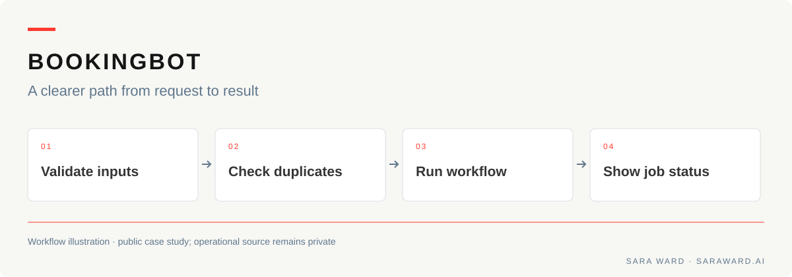

# BookingBot

An internal app for booking rerun ecommerce sales without repeating the same admin steps by hand.

[Operating guide](https://saraward.ai/bookingbot-docs-portfolio.html) · [Workflow and validation](docs/workflow.md) · [Portfolio](https://saraward.ai)

## At a glance

- **For:** ecommerce operators booking rerun sales through a repetitive admin workflow.
- **My contribution:** application and browser-automation development, workflow design, deployment packaging, and user documentation.
- **What this demonstrates:** making required inputs, duplicate requests, execution status, and recovery understandable to an operator.
- **Evidence:** [operating guide](https://saraward.ai/bookingbot-docs-portfolio.html) and [workflow / validation boundaries](docs/workflow.md).

**Status:** public documentation of a private internal application. The validation notes distinguish implemented behavior from proposed sandbox checks; this showcase does not publish a measured time-saving or booking-success rate.

## The problem

Booking a sale involves structured input, a line sheet, multiple admin interactions, and a confirmed result. Operators also need to know whether a request is still running and what to do when it fails.

## What I built

BookingBot puts the request, browser automation, and job status in one application:

1. Validate the booking details and uploaded line sheet.
2. Check for a matching request already in progress.
3. Run the browser workflow and inspect the result.
4. Show job status and debugging evidence for troubleshooting.

Explicit job states distinguish an accepted request from a completed booking, so the operator knows when action is needed.

**My role:** application and automation development, workflow design, deployment packaging, and user documentation. I wrote the operating guide around the user's journey, including setup, form fields, job states, and recovery.

**Built with:** JavaScript / Node.js · Playwright · HTTP APIs · file uploads · Docker · AWS container deployment

## Explore the work

The [operating guide](https://saraward.ai/bookingbot-docs-portfolio.html) shows how the implemented application works. The [validation notes](docs/workflow.md) separate documented behavior from proposed sandbox tests.

This repository is a public case study; the operational application and its configuration remain private.
